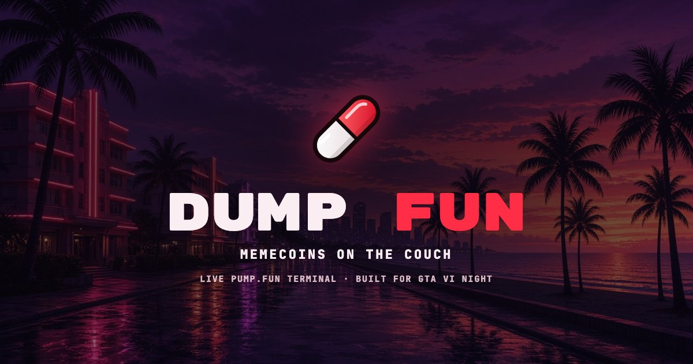
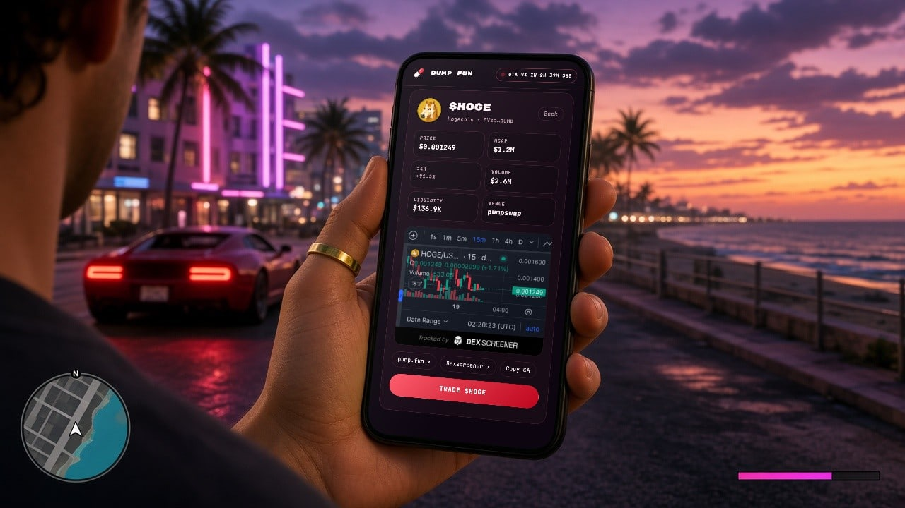
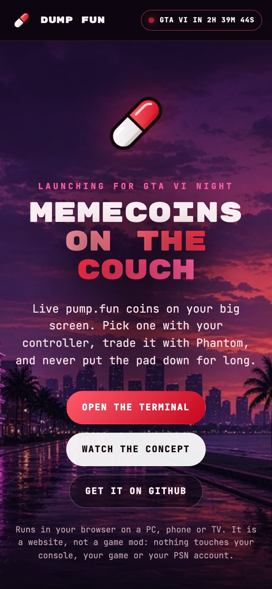
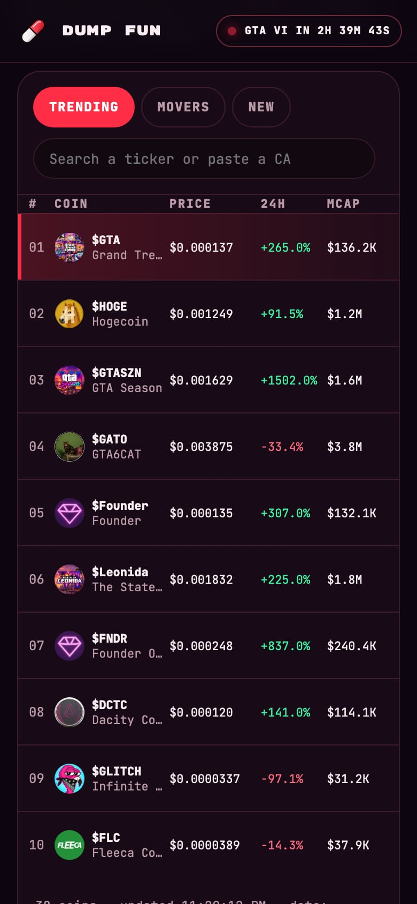
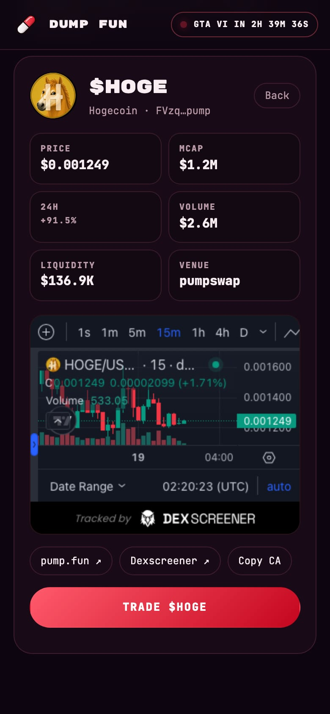
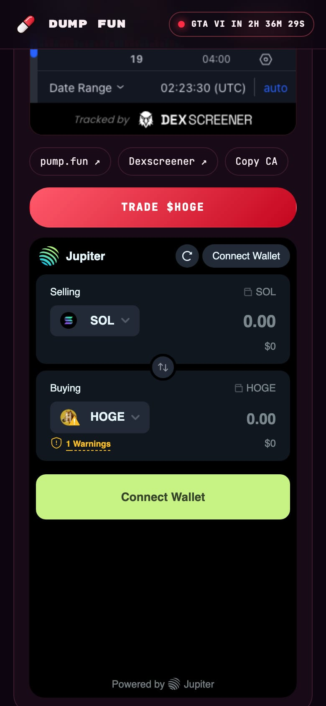

<p align="center">
  
</p>

<h1 align="center">Dump Fun</h1>

<p align="center"><b>pump.fun memecoins on the couch.</b><br />A live, controller-friendly pump.fun terminal for your big screen. Built for GTA VI night.</p>

<p align="center"><a href="https://www.soge.si/">Live site</a> · <a href="#run-it">Run it</a> · <a href="#faq">FAQ</a></p>



## What it is

Dump Fun is a single web page that shows pump.fun coins trending right now and lets you trade them with your own Phantom wallet. Keep it open on your phone, a PC or a TV browser next to the game, and drive it with a gamepad or the keyboard.

- **Live coins.** Trending, Movers and New tabs for Solana tokens whose mint ends in `pump`. Data from Dexscreener, refreshed every 20 seconds.
- **Search.** Type a ticker or paste a contract address.
- **Chart and numbers.** Price, market cap, 24h change, volume, liquidity and a live Dexscreener chart.
- **Trade.** The Jupiter swap widget opens preloaded with SOL → the coin. You connect Phantom and sign every swap yourself.
- **Controller support.** D-pad or arrows to move, ✕ / Enter to trade, ○ / Esc to go back, L1 / R1 to switch tabs.
- **No backend.** Plain HTML, CSS and JavaScript. No account, no custody, nothing stored.

## On mobile

The terminal is built for one thumb. Add it to your home screen and it opens like an app.



<p align="center">
  
  
  
  
</p>

The phone photo is an AI concept scene with a real Dump Fun screen composited onto the display. The four screens are real captures of the live site.

## Run it

```bash
git clone https://github.com/asdfghdevv/dump-fun
cd dump-fun
npx serve .
```

Then open the URL it prints. Any static file server works, including GitHub Pages.

## Files

| Path | What it holds |
| --- | --- |
| `index.html` | The page: hero, terminal, mobile, how-to, FAQ |
| `styles.css` | All styles |
| `app.js` | Dexscreener data, rendering, Jupiter swap, keyboard and gamepad input, countdown |
| `assets/` | Logo, icons, hero and share images |
| `media/` | Phone photo, mobile screens and the real screen-capture how-to video |

## Data and trading

- Token data: [Dexscreener API](https://docs.dexscreener.com/api/reference) (`token-boosts`, `token-profiles`, `tokens/v1/solana`, `latest/dex/search`). Trending lists include promoted tokens.
- Swaps: [Jupiter Plugin](https://dev.jup.ag/tool-kits/plugin). Dump Fun never sees your keys.

## FAQ

**Does it work on the PS5?** The PS5 has no official web browser, so use your phone, a PC or a smart TV browser beside it.

**Is it affiliated with pump.fun, Rockstar Games, Take-Two or Sony?** No. Dump Fun is an independent open-source parody. GTA VI is a trademark of Take-Two Interactive.

## Disclaimer

Memecoins are extremely risky and most go to zero. Nothing here is financial advice. Use at your own risk.

## License

[MIT](LICENSE)
